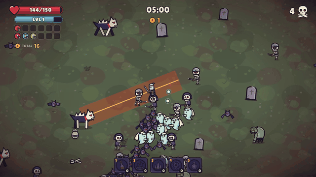

# Bloodfallen-Releases

Welcome to the Bloodfallen releases repository! Here, you'll find the bleeding edge versions of our game, designed for those who want to dive into the game's development from the ground up.
## What Is Bloodfallen?
Bloodfallen is a top-down, rogue-lite game. We're in the early stages, and your feedback is crucial to shaping the game's future.
## How To Get Involved
- **Download**: Get the latest build from [Releases](https://github.com/Lilium-Legacy-Games/bloodfallen-releases/releases): `bloodfallen-<version>-windows.zip` for Windows, `bloodfallen-<version>-linux.tar.gz` for Linux. From 0.4.0a on, the game updates itself from its main menu.
- **Feedback**: Encounter a bug or have a suggestion? Post it in the [Issues](https://github.com/Lilium-Legacy-Games/bloodfallen-releases/issues) section or email us at [liliumlegacygames@gmail.com](mailto:liliumlegacygames@gmail.com).
- **Testing**: Your role as a tester is invaluable. We encourage you to play, break, and report back to help us improve.

## Patch Notes
### Version 0.4.1a
- **New Features**:
  - Bloodfallen runs on Linux: download bloodfallen-0.4.1a-linux.tar.gz from the releases page, unpack it and run Bloodfallen.x86_64
  - The Linux version updates itself from the main menu, like the Windows one
  - The game has its own icon: a bleeding B before the blood moon, on your desktop and taskbar
- **Known Issues**:
  - The Linux version is new and has had little testing; tell us how it runs on your machine with FEEDBACK
  - Updating needs the game's folder to be one you can write to; if it isn't, the update screen offers the download page instead
  - Other heroes can wield the Knight's Sword, but only the Knight is drawn holding it
  - No Android build yet; it is coming

### Version 0.4.0a
- **New Features**:
  - The game now updates itself: when a new version is out, an UPDATE button appears in the main menu with what's new, and UPDATE NOW downloads it and restarts into it. This is the last version you need to download by hand
  - FEEDBACK in the main menu and on the pause screen: tell us what happened or what felt off, and it reaches us together with the run it is about
  - Run stats and errors are sent to us anonymously, so we can balance the game and fix bugs you never see. You can turn this off in OPTIONS (Send stats)
  - The Blood Aura throbs and the scythes swoop: neither is silent any more
  - Bosses roar when they arrive and when they enrage, and every boss attack has its own sound: slams, charges, the Abbess's tide, pools and beam
  - Enemy attacks give a low warning before they land
  - Each kind of enemy sounds like itself when hit and killed: bones rattle, bats squeak, spirits wail, armour clangs and the drowned burst
  - Each level has its own ambient sound under the music: wind, crows and an owl in the graveyard; dripping water and a chain in the crypt
- **Known Issues**:
  - Updating needs the game's folder to be one you can write to; if it isn't, the update screen offers the download page instead
  - Other heroes can wield the Knight's Sword, but only the Knight is drawn holding it
  - Windows only for now; an Android build is coming

### Version 0.3.1a
- **New Features**:
  - New hero: the Knight. Free from the start, with 150 health, a great helm and a longsword
  - New weapon: the Knight's Sword slashes in a wide arc where you aim, adds a back-swing at level 3, and any hero can find it in level-ups. With Vitality it evolves into Oathbreaker, three blood-red slashes that heal you for 3% of the damage they deal
  - Three Knight skins in the SHOP: Blackguard, Templar and Rusted Oath
  - Every hero has a new running animation and now attacks on the move without their legs stopping
  - A TOTAL coins counter under your inventory shows, live, your coins plus what ending the run now would pay
  - Achievement pop-ups now appear top right, beside the kill count
  - Barrels and urns break empty more often (a third of barrels, a fifth of urns) and hold fewer coins, so what they drop matters more
- **Bug Fixes**:
  - Enemies no longer get stuck behind landmarks or in pockets of decor; they walk around to reach you
  - The hero select and SKINS screens fit all four heroes
- **Known Issues**:
  - Other heroes can wield the Knight's Sword, but only the Knight is drawn holding it
  - Windows only for now; an Android build is coming

### Version 0.3.0a
- **New Features**:
  - Bigger maps: twice the area, with landmarks to fight around: mausoleums, ruined chapel walls and angel statues in the graveyard; shrines, crypt walls and drowned statues in the crypt
  - Tombstones, trees, statues and other decor now block you and the horde; enemies find their way around them, and your arrows still fly over
  - The camera shows 20% more of the arena
  - 18 achievements that pay coins, with pop-ups during runs and a list in the main menu
  - New main menu: the game plays behind it under a blood moon with fog, embers and lightning, your hero stands against the moon, the logo slams in and drips, and it shows your last run, your records and your next goal
  - Coins you just earned count up on the main menu
  - Patch notes in the main menu
  - Accessibility options: screen shake strength, HUD size, and high-visibility warnings and reticle
  - Rebindable keys for moving, dashing, pausing and throwing
  - The cursor is a pointer in menus and a reticle in runs that reacts to hits, kills and reloads
- **Known Issues**:
  - Balance is still being tuned, especially with the bigger maps and blocking terrain; tell us how runs feel
  - Windows only for now; an Android build is coming

### Version 0.2.1a
- **Bug Fixes**:
  - Beating the Drowned Abbess now says "DROWNED ABBESS DEFEATED!" instead of "WARDEN DEFEATED!"
  - If the Drowned Abbess dies mid-attack, her tide wave or beam no longer stays on screen as a magenta arc

### Version 0.2.0a
- **New Features**:
  - New level: the Drowned Crypt, with six new enemies and a new boss, the Drowned Abbess. Defeat the Blood Warden to open it; it pays 1.5x coins
  - Throwables: molotovs, arrow rain, bone spikes, gravewells and frost bombs. Buy them in the SHOP or find them, then throw them with keys 1-5 (hold and drag on touch)
  - Barrels, grave urns and cursed coffins break open for loot: heals, magnets, holy water, hourglasses, blood rage and shields
  - SHOP on the main menu with items and skins (three colour skins per hero)
  - Rerolls: swap a single level-up card
  - Revive once per run for coins on the GAME OVER screen
  - The Hunter, the Shade and the Blood Witch now look and play differently
  - On PC the longbow and daggers aim at your cursor; an option turns on auto-aim instead
  - Weapons look better: the aura pulses on each hit, firebombs leave flickering fire, lightning forks, and blades, arrows and daggers leave trails
  - Run stats: after each run, see damage per weapon, what hurt you, where your XP came from and when you picked each upgrade
  - New main menu: the game plays behind it, a card shows your last run, best time and total kills, a NEXT line names your next goal, UPGRADES shows NEW when you can afford something, and coins you just earned count up
- **Bug Fixes**:
  - The XP bar fills smoothly instead of in whole points
  - Big crowds no longer flash white
- **Known Issues**:
  - Balance is still being tuned; tell us if runs feel too easy or too hard
  - Windows only for now; an Android build is coming

### Version 0.1.0a
- **New Features**:
  - New look: all art and sound redone for a blood-moon graveyard
  - New enemies: skeletons, bats, banshees, ghouls, charging Gravehounds and Dreadguard elites
  - Survive 15 minutes, then defeat the Blood Warden boss to win the run
  - 7 weapons, each with an evolution, and 8 passives
  - You hold up to 6 weapons and 6 passives, each levelled up to 5
  - Experience drops as crystals to collect; enemies drop coins
  - Upgrades shop on the main menu: spend coins on 12 permanent upgrades, including Revival
  - Three playable characters: the Hunter, the Shade and the Blood Witch
  - New Run screen: choose your character and level before each run
  - Music for the menu, the run and the boss fight
  - Pause screen showing your build and how each weapon evolves
  - End-of-run summary
  - Options: music and sound volume, screen shake, damage numbers, 60 FPS and fullscreen
- **Bug Fixes**:
  - The "Options" button now opens the options
  - Movement speed is now capped
  - Fullscreen is no longer blurry
- **Known Issues**:
  - Balance is still being tuned; tell us if runs feel too easy or too hard
  - The Blood Witch's attack animation does not play
  - Windows only for now; an Android build is coming

### Version 0.0.1a
- **New Features**:
  - Enemy Spawns
  - Player Leveling
  - Basic Weapons/Abilities
- **Bug Fixes**:
  - Main Menu is now functional
- **Known Issues**:
  - Movement Speed Ability is missing a cap
  - "Options" Button is not functional
## License
This project is licensed under the [Creative Commons Attribution-NonCommercial 4.0 International License](https://creativecommons.org/licenses/by-nc/4.0/). You are free to:
- **Share** - copy and redistribute the material in any medium or format 
- **Adapt** - remix, transform, and build upon the material

The licensor cannot revoke these freedoms as long as you follow the license terms:
- **Attribution** - You must give appropriate credit, provide a link to the license, and indicate if changes were made. You may do so in any reasonable manner, but not in any way that suggests the licensor endorses you or your use.
- **NonCommercial** - You may not use the material for commercial purposes.
