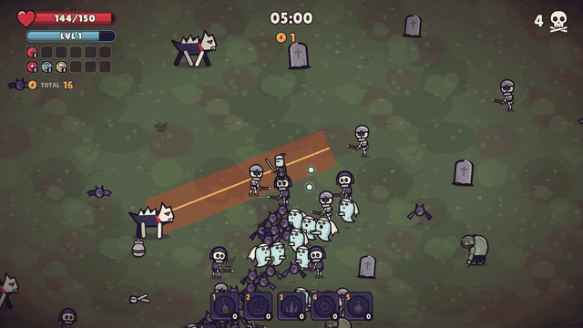

# Bloodfallen-Releases

Welcome to the Bloodfallen releases repository! Here, you'll find the bleeding edge versions of our game, designed for those who want to dive into the game's development from the ground up.
## What Is Bloodfallen?
Bloodfallen is a top-down, rogue-lite game. We're in the early stages, and your feedback is crucial to shaping the game's future.
## How To Get Involved
- **Download**: Get the latest build from [Releases](https://github.com/Lilium-Legacy-Games/bloodfallen-releases/releases): `bloodfallen-<version>-windows.zip` for Windows, `bloodfallen-<version>-linux.tar.gz` for Linux, `bloodfallen-<version>-android.apk` for Android (open it on your phone to install). From 0.4.0a on, the Windows and Linux versions update themselves from the main menu; on Android the main menu tells you when a new version is out and DOWNLOAD opens its release page, and installing the new APK keeps your progress.
- **Feedback**: Encounter a bug or have a suggestion? Post it in the [Issues](https://github.com/Lilium-Legacy-Games/bloodfallen-releases/issues) section or email us at [liliumlegacygames@gmail.com](mailto:liliumlegacygames@gmail.com).
- **Testing**: Your role as a tester is invaluable. We encourage you to play, break, and report back to help us improve.

## Patch Notes
### Version 0.5.13a
- **New Features**:
  - Mini bosses: two on every level come before its boss, at 5 and 10 minutes in Survival and after waves 3 and 6 in Waves mode. The Graveyard has the Gravedigger and the Headless Knight, the Crypt the Bell-Ringer and the Lantern Keeper, the Dunes the Scarab King and the High Vizier, each with its own look and attacks
  - As a mini boss arrives the crowd is cleared and its health bar comes up; the run's clock waits until it falls. It leaves a gold chest of 5 rewards
  - Waves mode has 9 waves, with the mini bosses after the third and the sixth and the boss after the ninth
  - Ghosts no longer shoot: the Banshee, the Wraith and the Sun Priest are each level's fastest enemy and drift straight through tombstones, crosses and every other obstacle
  - An elite's chest is now always a bronze one with 1 reward, and a mini boss's gold chest looks its own: larger, domed and ornate
  - A chest's rewards can be skipped: a tap, click or any key lands the reward that's spinning and starts the next. Once all are shown they glow, and one more press claims them
- **Bug Fixes**:
  - The Hunter draws his bow after each shot instead of before it, and the arrow on his bow no longer blinks out and back. The Shade and the Blood Witch's attacks are timed the same way
  - The kill count stays on one line on a phone, however many kills

### Version 0.5.12a
- **New Features**:
  - The Blood Moon is new: for half a minute every enemy moves faster, and a shaft of moonlight falls on a pool near you. Standing in it heals you and doubles your damage, and it moves on every few seconds
  - A stampede now charges three times, ten seconds apart, each time from a different side
  - The treasure ghoul stays 40 seconds. When it gets away, it sprints off through the palisade and out of sight instead of vanishing
  - A chest's rewards spin slower and slow down as they land, and stay on screen for 3 seconds
  - The Hunter's Arrow Storm covers a wider spot and leaves the ground burning for 3 seconds, hurting enemies that cross it
  - The Arrow Rain throwable covers a smaller spot
- **Bug Fixes**:
  - The treasure ghoul's marker stays at the screen's edge nearest the ghoul: it no longer jumps across the screen or disappears
  - The treasure ghoul no longer twitches on the spot when you get close: it keeps running, along the palisade if it has to
  - A stampede's warning arrows no longer cover the level-up cards and their reroll buttons
  - A stampede's runners come in from out of sight and run over you, hurting you as they pass, instead of bumping into you

### Version 0.5.11a
- **New Features**:
  - Elites drop treasure chests: the first elite of a run always, later ones 1 in 3. A bronze, silver or gold chest holds 1, 3 or 5 rewards that spin in one by one, then fly to where they show: coins, a free level, XP, a full heal, Blood Rage, a reroll or a throwable
  - Map events break up a run: the Blood Moon (twice the enemies and twice the XP), a stampede of the level's swarm across the screen, and Rising Graves, where for half a minute rings of graves open around you and erupt
  - A treasure ghoul turns up twice a run and runs from you: catch it within 30 seconds for 20 coins. A marker at the screen's edge shows where it is
  - The Shield's bubble is a ring of glowing shield plates that turns around the hero and no longer hides them
- **Bug Fixes**:
  - The war horn at the start of a wave is a real battle horn and carries over the music
  - Button labels that barely fit in some languages are shorter
  - When only two upgrades are left, their cards sit in the middle of the screen
  - An achievement's coins no longer count towards what the run earned; they still go into your total
  - The Hunter's longbow is weaker at its top levels: smaller explosions, and the evolved bow fires 3 arrows that pierce 3 enemies

### Version 0.5.10a
- **New Features**:
  - A war horn sounds as each wave starts in Waves mode
  - A cleared wave is celebrated first, with its own sound, while its crystals and coins fly to you; the level-up cards come after
  - The Knight's second special is Consecrate, in place of Shield Charge: he plants his sword in holy ground that burns and slows enemies and heals him while he stands in it
  - The Hunter is redrawn with more detail: a face under his hood, a laced jerkin, gloves, boots and a wrapped bow
  - One flask: the Firebomb is gone, and the Hex Flask is aimed only as the Blood Witch's main weapon. Taken from a level-up, or by a Witch on the Briar Staff, it flies at the nearest enemy
- **Bug Fixes**:
  - When several levels come at once, every level's cards are as big as the first's
  - The coins a run earns sit beside TOTAL under the inventory instead of in the middle of the screen
  - The end screen explains a run's coins right beside its coin total
  - On a phone the boss's health bar no longer covers the level-up cards

### Version 0.5.9a
- **New Features**:
  - Bloodfallen speaks seven languages: English, Bosnian, German, French, Spanish, Russian and Turkish. Pick one with Language in the main menu's OPTIONS; the first start uses your device's language
  - Every screen, card, hero, weapon, level, tip and achievement is translated, and the level-up cards write their names in your language
- **Bug Fixes**:
  - The Bone Armor icon is a new shield without the X across it
  - The Regeneration icon's arrow is smaller, sits inside its heart, and its head lines up with the arrow
  - The Knight's Sword icon no longer reaches outside its medallion
  - Waves mode no longer jumps in difficulty at the last wave: the middle waves are a little harder and the tenth gentler
  - A run pays about a third fewer coins, from every source but achievements: one run filled the shop too fast
  - A boss's name no longer shows over the level-up cards, and the coin counter moves beside the boss bar instead of under it
- **Known Issues**:
  - The translations are a first pass; tell us with FEEDBACK if a word reads wrong or a text doesn't fit
  - Patch notes stay in English

### Version 0.5.8a
- **New Features**:
  - On a phone, the MASTERY screen's hero portraits along the top are bigger
  - On a phone, the equipped weapon and special on the MASTERY screen are drawn bigger, and the list of levels is narrower to make room
- **Bug Fixes**:
  - On a phone, the MASTERY button no longer covers the bottom of the last run's card; it sits beside FEEDBACK

### Version 0.5.7a
- **New Features**:
  - Hero Mastery: every hero earns mastery from their runs, for minutes survived, kills and wins, and the MASTERY screen in the main menu shows each hero's levels
  - Mastery levels give small lasting bonuses (more damage, more health, shorter cooldowns, more coins) and a crest at the top level
  - Each hero unlocks a second special and a second starting weapon through mastery, and you choose which to equip on the MASTERY screen
  - New specials: Arrow Storm for the Hunter, Shield Charge for the Knight, Rampage for the Juggernaut, Smoke Veil for the Shade and Blood Pact for the Blood Witch
  - New weapons, one for each hero: the Hunter's Crossbow, the Knight's Mace, the Juggernaut's Great Axe that sweeps three quarters of the way round him, the Shade's Shuriken and the Blood Witch's Briar Staff, whose thorns slow what they catch
  - Every hero is drawn holding the weapon they have equipped, with its own attack animation
  - The Shade's first special is now the Fan of Knives, thrown out all round her; Smoke Veil is the one she unlocks
  - Weapon cards say where a weapon goes: where you aim, or with auto-aim on, at the nearest enemy or the way you move
- **Bug Fixes**:
  - The Knight's Mace leaves only a dent in the ground where it lands, not a big mace lying on the floor
  - The Juggernaut's Great Axe is only ever the one in his hands; its sweep shows as a slash, like the Knight's sword
  - The Blood Witch's Blood Pact has its own sound as it is sealed
  - The Knight's sword slashes a slightly narrower arc
  - The Hex Flask is thrown less often, and each flask hits harder
  - The Longbow, Daggers and Hex Flask cards no longer claim to aim at the nearest enemy when you aim them yourself

### Version 0.5.6a
- **New Features**:
  - The Juggernaut's hammer leaves a smaller, softer mark that suits each level: turned soil and clods in the Blood-Moon Graveyard, a cracked flagstone in the Drowned Crypt and a dip in the sand in the Sunken Dunes, with dust in the ground's own colour
  - On a phone, aimed specials are steered like a stick: drag from the special button the way you want it to go, and for the Blood Moon, how far you drag is how far out it lands; drag back to the middle of the button and let go to cancel
- **Bug Fixes**:
  - On a phone, the Hunter's Heartseeker can be aimed down and to the right; before, dragging that way went back over the button and cancelled it
  - In the shop's SKINS tab, the last row of skins (the Blood Witch's) no longer sits under the BACK button on PC
  - On a phone, the shop's SKINS tab scrolls all the way down to the Blood Witch's skins

### Version 0.5.5a
- **New Features**:
  - A new hero, the Juggernaut (900 coins): a tank with the most health, who takes 20% less damage but moves slower, and hurts enemies that press against him
  - The Juggernaut's Warhammer slams the ground all around him and leaves a crater; from level 3 it sends shockwaves rolling out, and with Armor it evolves into Earthbreaker, whose waves stun
  - Three skins for the Juggernaut in the shop
  - Every hero has a special ability on its own button with a cooldown: Heartseeker for the Hunter, Whirlwind for the Knight, Smoke Veil for the Shade, Blood Moon for the Blood Witch and Earthshatter for the Juggernaut
  - On PC the special is on Q (change it in OPTIONS); on a phone, tap the special button to use it, or drag from it to aim
  - The Blood Witch now throws Hex Flasks on her own, and you choose where they land within her reach; a grey circle shows the spot
  - The Blood Witch starts with a weaker Blood Aura, which level-up cards can still raise and evolve
  - The game over screen says what killed you
  - The hero cards on the run setup screen turn in pages, with arrows and a dot per page beside CHARACTER, and each card names its hero's special
  - 11 new achievements, among them goals for the Sunken Dunes, for winning in Waves and for using your special
  - New tips on the main menu about specials, the Juggernaut, the Blood Witch and Waves
  - Runs pay about 30% fewer coins, from every source: drops, elites, bosses, barrels, urns, coffins, time survived, waves and the win bonus
  - Achievements pay about 30% fewer coins
  - Enemies grow tougher faster as a run goes on, most of all in the Blood-Moon Graveyard, to make up for the new specials
- **Bug Fixes**:
  - With a full build, the stats screen's last upgrade no longer hides under the BACK button

### Version 0.5.4a
- **New Features**:
  - On phones, the level-up cards are a little smaller and sit in the middle of the screen under the title
  - On phones, the health bar, XP bar, inventory and total coins sit a little nearer the left edge, leaving more of the arena in view
- **Bug Fixes**:
  - When a cleared wave gives several levels, the last level's cards no longer flash back for a moment before the next level's cards appear

### Version 0.5.3a
- **New Features**:
  - A new mode, Waves: pick SURVIVAL or WAVES on the NEW RUN screen, beside the levels
  - In Waves, each level sends ten named waves, each bigger and tougher than the last, and its boss comes once the last one is cleared
  - Clearing a wave gathers every coin and XP crystal on the map, gives you a free level and some coins, then a short breather before the next wave
  - When a cleared wave gives you several levels, you pick every card one after another and the fight resumes once, after the last
  - A bar under the wave counter shows how many enemies are left, or counts down to the next wave
  - Each level now opens by winning the one before it in both Survival and Waves, and the NEW RUN screen stars each mode you've won
  - On phones, the LEVEL UP! title is smaller and the upgrade cards and their text are bigger

### Version 0.5.2a
- **New Features**:
  - Two players can play together on one PC: on the NEW RUN screen, press + PLAYER 2, or A on a gamepad, or Right Shift on the keyboard, and each player picks their own hero
  - Player 2 moves with a gamepad's left stick or the arrow keys and dashes with a bumper, X or Right Shift; their weapons aim themselves
  - The camera keeps both heroes on screen, each hero wears a ring and a health bar in their colour, and player 2's weapons and upgrades show in the top-right corner
  - XP is shared: at every level-up both heroes level up, a fallen partner gets back up, and each player picks their own card in turn
  - Enemies and the boss are tougher when two of you play

### Version 0.5.1a
- **New Features**:
  - Picking a level-up card shows what you got: the card rises with a soft glow, a ribbon names the upgrade, then it flies into your inventory
  - Closing the pause screen counts down before the fight resumes, just like after a level-up
  - Choose how long that countdown is, 1, 2 or 3 seconds, under ACCESSIBILITY
  - The charging beasts are redrawn: the Gravehound is now a skull-faced barghest, and the Lurker and Jackal have new looks too
  - Chargers crouch and tense before they pounce, leave a trail as they lunge and land with a skid of dust; their warning is a soft lane with a small arrow
  - Lightning has a new crackling sound, and picking up a health potion now sounds like drinking it instead of a bell
  - Banshees sound lower and softer when hit and when they die
- **Bug Fixes**:
  - The flask's throw sound no longer cuts off at the end
  - On PC, Space only dashes: it no longer presses the last button you clicked, such as a level-up card

### Version 0.4.10a
- **New Features**:
  - Bosses fight you, not the crowd: their roar clears every enemy on the map, only a few come back during the fight, and they hit harder and attack more often; dodge their warnings
  - The Sun-Scorched Pharaoh has less health, so his fight no longer drags on for minutes
  - New sound effects, recorded rather than synthesized: the bow, blades, hits, deaths, coins, pickups, explosions, boss attacks and more
  - Common sounds such as hits, deaths, coins and arrows have several takes, so a crowd doesn't sound like one noise repeated
  - The Blood Witch's Bloodburst: enemies that die in her aura burst and hurt those around them, and the bursts chain through a packed crowd; her area bonus is now 30%
  - The Shade's Shadowstep: she starts with the dash, kills recharge it, and right after a dash she deals double damage
  - Level-up cards and the shop say what each rank adds (Vitality: +16 max health) instead of the total so far
  - Volley's ranks that add no extra shot now add 10% damage to the weapons it boosts
  - Screen shake starts at 30%; turn it up or down under ACCESSIBILITY
- **Bug Fixes**:
  - The scythes and the Blood Aura make their sound when they hit something, instead of on a timer whether anything was there or not

### Version 0.4.9a
- **New Features**:
  - A third level, the Sunken Dunes, opens once you beat the Drowned Crypt: mummies, scarabs, sun priests, scorpions and scarab queens that burst into scarabs, with jackals that charge and tomb guardians as its elites
  - At the end of the Sunken Dunes waits the Sun-Scorched Pharaoh, who raises mummies from the sand and sends out spiralling streams of suns; slip through the gaps between them
  - The Sunken Dunes are the hardest level yet, have their own music and desert wind, and pay twice the coins
  - The first few minutes of every level are gentler: enemies start with less health and damage and reach full strength by minute 6
  - On phones, the game buzzes when you're hit, when you level up and when a boss arrives; turn it off with VIBRATION in the options
  - Leaving the game in the middle of a run (the home button, a call, switching windows) pauses it
  - On phones with a notch or rounded corners, the HUD, the menu's buttons and every window stay clear of them
- **Bug Fixes**:
  - On phones, the patch notes shown after an update no longer run off the edges of the screen

### Version 0.4.8a
- **Bug Fixes**:
  - The update screen's download bar no longer spills over the left edge of its track as a download starts; it fills from the left, inside the track

### Version 0.4.7a
- **New Features**:
  - Crimson Bloom, the Blood Aura's evolution, heals at most 0.15% of your health a pulse instead of 0.3%
  - The Knight's Sword reaches 10% less far at every level, Oathbreaker included
  - Every hero level adds 1% damage instead of 1.5%
  - Volley gives Lightning half its extra bolts, rounded down: +1 at Volley 3 to 5 instead of +2 or +3, and none at Volley 1 and 2 instead of +1
  - Every level-up heals 10% of your health instead of 20%
  - Bone Armor tops out at 17% less damage taken instead of 25% (4%, 7%, 10%, 14% and 17% by level)

### Version 0.4.6a
- **New Features**:
  - Android can now update itself: UPDATE NOW downloads the new version and opens Android's installer, so there's no need to find the APK on the release page
  - The first Android update asks you to allow Bloodfallen to install apps; your progress is kept through every update
  - Oathbreaker, the Knight's evolved sword, now heals 0.5% of the damage it deals instead of 2%
  - Lightning chains to fewer enemies late on: 3 at level 5 instead of 4, and Tempest throws 3 bolts that chain to 4 instead of 4 that chain to 6
  - Lightning's level 5 deals 30 damage instead of 34, and Tempest deals 36 instead of 41
  - Blood Aura's level 5 deals 10 damage instead of 12, pulses every 0.45 seconds instead of 0.4 and reaches a little less far
  - Crimson Bloom, the Blood Aura's evolution, deals 12 damage instead of 15, pulses every 0.45 seconds instead of 0.4, is smaller and heals at most 0.3% of your health a pulse instead of 0.5%

### Version 0.4.5a
- **New Features**:
  - Every level-up heals 20% of your health, with a green burst over your hero to show it
  - Once every weapon and passive is maxed, a level-up just heals you: the game no longer stops for an empty level-up screen
  - The Banshee has a new look, and ranged enemies now fire wailing ectoplasm wisps that face the way they fly
  - Frozen enemies thaw before they break free: their colour warms, they shudder and the ice cracks off, so they no longer catch you off guard
  - The dash button stays on screen through its cooldown, greyed out with the seconds left, like the throwables
  - The main menu shows tips, one at a time; click or tap the panel for the next one
  - Hellfire, the Firebomb's evolution, burns a deeper red-orange instead of green, with fewer flames crowding the ground
  - Oathbreaker, the Knight's evolved sword, now heals 2% of the damage it deals instead of 3%
- **Bug Fixes**:
  - The coin count under the timer now shows everything the run will pay (the time bonus, Greed and achievements too), so it matches your total
  - On phones, the pause menu is no longer cut off at the top and bottom
  - The level-up screen sits in the middle of the screen instead of riding high
  - The LAST RUN card on the main menu lines up with the FEEDBACK button

### Version 0.4.4a
- **New Features**:
  - On phones everything is bigger: the menus, every window and the HUD are drawn 1.4 times larger, and the camera is closer in a run
  - On phones, aim with a second stick on the right of the screen, the way the mouse aims on PC
  - Auto-aim is now an option on phones too, off by default; turn it on in OPTIONS to have the weapons find their own targets
  - Long lists on phones (upgrades, the shop, options, achievements, patch notes) scroll, with a scroll bar you can drag
  - On phones, NEW RUN shows the characters, the levels and START on one screen
- **Bug Fixes**:
  - On phones, the LEVEL UP! title no longer covers the timer, and the reroll buttons are no longer hidden behind the throwables
  - On phones, the game over buttons no longer fall off the bottom of the screen
  - The revive note sits right under the REVIVE button instead of below the other buttons

### Version 0.4.3a
- **New Features**:
  - Bloodfallen runs on Android: download bloodfallen-0.4.3a-android.apk from the releases page on your phone and open it to install
  - On Android, the main menu tells you when a new version is out; DOWNLOAD opens the release page, and installing the new APK keeps your progress
  - Barrels and urns drop gold coins more often: coins are now their most likely drop, and they break empty less often

### Version 0.4.2a
- **Bug Fixes**:
  - The PATCH NOTES list of versions scrolls instead of spilling out of the bottom of the screen

### Version 0.4.1a
- **New Features**:
  - Bloodfallen runs on Linux: download bloodfallen-0.4.1a-linux.tar.gz from the releases page, unpack it and run Bloodfallen.x86_64
  - The Linux version updates itself from the main menu, like the Windows one
  - The game has its own icon: a bleeding B before the blood moon, on your desktop and taskbar

### Version 0.4.0a
- **New Features**:
  - The game now updates itself: when a new version is out, an UPDATE button appears in the main menu with what's new, and UPDATE NOW downloads it and restarts into it. This is the last version you need to download by hand
  - FEEDBACK in the main menu and on the pause screen: tell us what happened or what felt off, and it reaches us together with the run it is about
  - Run stats and errors are sent to us anonymously, so we can balance the game and fix bugs you never see. You can turn this off in OPTIONS (Send stats)
  - The Blood Aura throbs and the scythes swoop: neither is silent any more
  - Bosses roar when they arrive and when they enrage, and every boss attack has its own sound: slams, charges, the Abbess's tide, pools and beam
  - Enemy attacks give a low warning before they land
  - Each kind of enemy sounds like itself when hit and killed: bones rattle, bats squeak, spirits wail, armour clangs and the drowned burst
  - Each level has its own ambient sound under the music: wind, crows and an owl in the graveyard; dripping water and a chain in the crypt

### Version 0.3.1a
- **New Features**:
  - New hero: the Knight. Free from the start, with 150 health, a great helm and a longsword
  - New weapon: the Knight's Sword slashes in a wide arc where you aim, adds a back-swing at level 3, and any hero can find it in level-ups. With Vitality it evolves into Oathbreaker, three blood-red slashes that heal you for 3% of the damage they deal
  - Three Knight skins in the SHOP: Blackguard, Templar and Rusted Oath
  - Every hero has a new running animation and now attacks on the move without their legs stopping
  - A TOTAL coins counter under your inventory shows, live, your coins plus what ending the run now would pay
  - Achievement pop-ups now appear top right, beside the kill count
  - Barrels and urns break empty more often (a third of barrels, a fifth of urns) and hold fewer coins, so what they drop matters more
- **Bug Fixes**:
  - Enemies no longer get stuck behind landmarks or in pockets of decor; they walk around to reach you
  - The hero select and SKINS screens fit all four heroes

### Version 0.3.0a
- **New Features**:
  - Bigger maps: twice the area, with landmarks to fight around: mausoleums, ruined chapel walls and angel statues in the graveyard; shrines, crypt walls and drowned statues in the crypt
  - Tombstones, trees, statues and other decor now block you and the horde; enemies find their way around them, and your arrows still fly over
  - The camera shows 20% more of the arena
  - 18 achievements that pay coins, with pop-ups during runs and a list in the main menu
  - New main menu: the game plays behind it under a blood moon with fog, embers and lightning, your hero stands against the moon, the logo slams in and drips, and it shows your last run, your records and your next goal
  - Coins you just earned count up on the main menu
  - Patch notes in the main menu
  - Accessibility options: screen shake strength, HUD size, and high-visibility warnings and reticle
  - Rebindable keys for moving, dashing, pausing and throwing
  - The cursor is a pointer in menus and a reticle in runs that reacts to hits, kills and reloads

### Version 0.2.1a
- **Bug Fixes**:
  - Beating the Drowned Abbess now says "DROWNED ABBESS DEFEATED!" instead of "WARDEN DEFEATED!"
  - If the Drowned Abbess dies mid-attack, her tide wave or beam no longer stays on screen as a magenta arc

### Version 0.2.0a
- **New Features**:
  - New level: the Drowned Crypt, with six new enemies and a new boss, the Drowned Abbess. Defeat the Blood Warden to open it; it pays 1.5x coins
  - Throwables: molotovs, arrow rain, bone spikes, gravewells and frost bombs. Buy them in the SHOP or find them, then throw them with keys 1-5 (hold and drag on touch)
  - Barrels, grave urns and cursed coffins break open for loot: heals, magnets, holy water, hourglasses, blood rage and shields
  - SHOP on the main menu with items and skins (three colour skins per hero)
  - Rerolls: swap a single level-up card
  - Revive once per run for coins on the GAME OVER screen
  - The Hunter, the Shade and the Blood Witch now look and play differently
  - On PC the longbow and daggers aim at your cursor; an option turns on auto-aim instead
  - Weapons look better: the aura pulses on each hit, firebombs leave flickering fire, lightning forks, and blades, arrows and daggers leave trails
  - Run stats: after each run, see damage per weapon, what hurt you, where your XP came from and when you picked each upgrade
  - New main menu: the game plays behind it, a card shows your last run, best time and total kills, a NEXT line names your next goal, UPGRADES shows NEW when you can afford something, and coins you just earned count up
- **Bug Fixes**:
  - The XP bar fills smoothly instead of in whole points
  - Big crowds no longer flash white

### Version 0.1.0a
- **New Features**:
  - New look: all art and sound redone for a blood-moon graveyard
  - New enemies: skeletons, bats, banshees, ghouls, charging Gravehounds and Dreadguard elites
  - Survive 15 minutes, then defeat the Blood Warden boss to win the run
  - 7 weapons, each with an evolution, and 8 passives
  - You hold up to 6 weapons and 6 passives, each levelled up to 5
  - Experience drops as crystals to collect; enemies drop coins
  - Upgrades shop on the main menu: spend coins on 12 permanent upgrades, including Revival
  - Three playable characters: the Hunter, the Shade and the Blood Witch
  - New Run screen: choose your character and level before each run
  - Music for the menu, the run and the boss fight
  - Pause screen showing your build and how each weapon evolves
  - End-of-run summary
  - Options: music and sound volume, screen shake, damage numbers, 60 FPS and fullscreen
- **Bug Fixes**:
  - The "Options" button now opens the options
  - Movement speed is now capped
  - Fullscreen is no longer blurry

### Version 0.0.1a
- **New Features**:
  - Enemy Spawns
  - Player Leveling
  - Basic Weapons/Abilities
- **Bug Fixes**:
  - Main Menu is now functional
## License
This project is licensed under the [Creative Commons Attribution-NonCommercial 4.0 International License](https://creativecommons.org/licenses/by-nc/4.0/). You are free to:
- **Share** - copy and redistribute the material in any medium or format 
- **Adapt** - remix, transform, and build upon the material

The licensor cannot revoke these freedoms as long as you follow the license terms:
- **Attribution** - You must give appropriate credit, provide a link to the license, and indicate if changes were made. You may do so in any reasonable manner, but not in any way that suggests the licensor endorses you or your use.
- **NonCommercial** - You may not use the material for commercial purposes.
