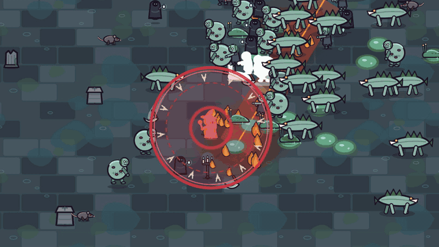

# Bloodfallen-Releases

Welcome to the Bloodfallen releases repository! Here, you'll find the bleeding edge versions of our game, designed for those who want to dive into the game's development from the ground up.
## What Is Bloodfallen?
Bloodfallen is a top-down, rogue-lite game. We're in the early stages, and your feedback is crucial to shaping the game's future.
## How To Get Involved
- **Download**:  Check the [Releases](https://github.com/Lilium-Legacy-Games/bloodfallen-releases/releases) section for the latest build.
- **Feedback**: Encounter a bug or have a suggestion? Post it in the [Issues](https://github.com/Lilium-Legacy-Games/bloodfallen-releases/issues) section or email us at [liliumlegacygames@gmail.com](mailto:liliumlegacygames@gmail.com).
- **Testing**: Your role as a tester is invaluable. We encourage you to play, break, and report back to help us improve.

## Patch Notes
### Version 0.2.0a
- **New Features**:
  - New level: the Drowned Crypt, with six new enemies and a new boss, the Drowned Abbess. Defeat the Blood Warden to open it; it pays 1.5x coins
  - Throwables: molotovs, arrow rain, bone spikes, gravewells and frost bombs. Buy them in the SHOP or find them, then throw them with keys 1-5 (hold and drag on touch)
  - Barrels, grave urns and cursed coffins break open for loot: heals, magnets, holy water, hourglasses, blood rage and shields
  - SHOP on the main menu with items and skins (three colour skins per hero)
  - Rerolls: swap a single level-up card
  - Revive once per run for coins on the GAME OVER screen
  - The Hunter, the Shade and the Blood Witch now look and play differently
  - On PC the longbow and daggers aim at your cursor; an option turns on auto-aim instead
  - Weapons look better: the aura pulses on each hit, firebombs leave flickering fire, lightning forks, and blades, arrows and daggers leave trails
  - Run stats: after each run, see damage per weapon, what hurt you, where your XP came from and when you picked each upgrade
  - New main menu: the game plays behind it, a card shows your last run, best time and total kills, a NEXT line names your next goal, UPGRADES shows NEW when you can afford something, and coins you just earned count up
- **Bug Fixes**:
  - The XP bar fills smoothly instead of in whole points
  - Big crowds no longer flash white
- **Known Issues**:
  - Balance is still being tuned; tell us if runs feel too easy or too hard
  - Windows only for now; an Android build is coming

### Version 0.1.0a
- **New Features**:
  - New look: all art and sound redone for a blood-moon graveyard
  - New enemies: skeletons, bats, banshees, ghouls, charging Gravehounds and Dreadguard elites
  - Survive 15 minutes, then defeat the Blood Warden boss to win the run
  - 7 weapons, each with an evolution, and 8 passives
  - You hold up to 6 weapons and 6 passives, each levelled up to 5
  - Experience drops as crystals to collect; enemies drop coins
  - Upgrades shop on the main menu: spend coins on 12 permanent upgrades, including Revival
  - Three playable characters: the Hunter, the Shade and the Blood Witch
  - New Run screen: choose your character and level before each run
  - Music for the menu, the run and the boss fight
  - Pause screen showing your build and how each weapon evolves
  - End-of-run summary
  - Options: music and sound volume, screen shake, damage numbers, 60 FPS and fullscreen
- **Bug Fixes**:
  - The "Options" button now opens the options
  - Movement speed is now capped
  - Fullscreen is no longer blurry
- **Known Issues**:
  - Balance is still being tuned; tell us if runs feel too easy or too hard
  - The Blood Witch's attack animation does not play
  - Windows only for now; an Android build is coming

### Version 0.0.1a
- **New Features**:
  - Enemy Spawns
  - Player Leveling
  - Basic Weapons/Abilities
- **Bug Fixes**:
  - Main Menu is now functional
- **Known Issues**:
  - Movement Speed Ability is missing a cap
  - "Options" Button is not functional
## License
This project is licensed under the [Creative Commons Attribution-NonCommercial 4.0 International License](https://creativecommons.org/licenses/by-nc/4.0/). You are free to:
- **Share** - copy and redistribute the material in any medium or format 
- **Adapt** - remix, transform, and build upon the material

The licensor cannot revoke these freedoms as long as you follow the license terms:
- **Attribution** - You must give appropriate credit, provide a link to the license, and indicate if changes were made. You may do so in any reasonable manner, but not in any way that suggests the licensor endorses you or your use.
- **NonCommercial** - You may not use the material for commercial purposes.
